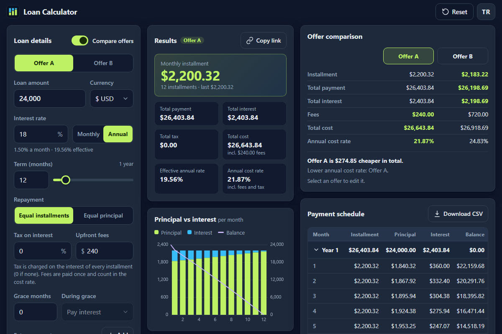

# Loan Calculator - see what a loan really costs, month by month

[](#tests)
[](LICENSE)

**▶ Open the app: https://celaldrg.github.io/loan-calculator/**



A loan calculator that runs entirely in your browser: no sign-up, no tracking, no build step. Every amount is computed in whole cents, so the schedule adds up to the last cent.

## Features

- Equal installments or equal principal, monthly or annual interest rate, terms from 1 month to 50 years
- Tax on interest (for example KKDF and BSMV in Turkey), upfront fees, grace months that either pay the interest or add it to the balance
- Up to 24 extra payments, one-off or recurring, that shorten the term or lower the installment, with the interest and time they save
- Results: installment, total payment, total interest, total tax, total cost, effective annual rate and the annual cost rate including fees and tax
- Principal vs interest chart: stacked bars per month (per year for loans over five years) and the remaining balance as a line
- Payment schedule grouped by year, with a sticky header that scrolls in its own box on phones, and CSV export
- Two offers side by side, with the cheaper one and the lower cost rate named
- Work back from an installment you can afford: largest loan, interest rate or shortest term
- Share a calculation as a link; the inputs live in the URL query
- Currency select (TRY, USD, EUR) that only changes the formatting; amounts are grouped as you type (1,234.56 or 1.234,56)
- English and Turkish, and the choice is remembered

## How to use

Fill in the loan on the left; everything else updates as you type.

Keyboard

- Tab and Shift+Tab reach every control; Space or Enter presses buttons and switches, the arrow keys move inside the option groups
- Term slider: Left and Right step through the terms, Home and End jump to 1 month and 50 years
- Chart: tab to it, then Left and Right step through the months (or years), Home and End jump to the first and last, Escape hides the details
- Schedule: Enter on a year row opens or closes its months; "Expand all" and "Download CSV" sit above the table
- Reverse solver: type an installment, pick what to find, then press Enter or "Use this" to copy the answer into the form

Touch

- Amount fields open the number pad and add the separators for you
- Drag the term slider; tap a bar or slide a finger sideways across the chart to read each month
- The schedule scrolls inside its own box, the header and the month column stay put
- On phones a bar at the bottom keeps the installment and the total in view; tap it to jump to the results

Address options: `?demo` opens a 12-month example with two offers to compare, `?lang=tr` or `?lang=en` picks the language. "Copy link" puts the current inputs into the address so whoever opens it sees the same loan.

## Run locally

```sh
npx serve .
```

Then open the address it prints. ES modules need http://, not file://, so opening `index.html` straight from disk does not work.

## Tests

```sh
node --test
```

No dependencies, Node 22 in CI. The tests cover the schedule engine (equal installments, equal principal, tax on interest, grace periods, zero interest, rounding drift), extra payments, the rate, amount and term solvers and the cost rate, input validation, offer comparison, share links, CSV export, number formatting and parsing in both styles, the offer workspace, the chart and table helpers, the English and Turkish strings, and storage that is missing or throws.

## Project structure

```
index.html        page markup; every visible string goes through data-i18n
style.css         dark theme, mobile-first layout
src/
  calculator.js   form inputs -> validated parameters -> schedule, totals, rates
  loan.js         schedule engine in integer cents
  solvers.js      rate, amount and term solvers, annual cost rate
  offers.js       one or two offers, shareable query
  share.js        inputs <-> URL query
  view-model.js   pure helpers for the chart, table and form texts
  format.js       numbers, money and percents in English or Turkish style
  i18n.js         English and Turkish strings
  storage.js      the only place that touches localStorage
  *-view.js       form, results, chart, comparison, table and solver views
  main.js         entry point that wires the views together
test/             node --test suites
docs/             screenshot
```

## License

MIT, see [LICENSE](LICENSE).

## Türkçe

Bir kredinin gerçekte neye mal olduğunu ay ay gösteren, tamamen tarayıcıda çalışan kredi hesaplayıcı. Üyelik, izleme ya da derleme adımı yok; her tutar kuruş kuruş hesaplanır.

**▶ Uygulamayı aç: https://celaldrg.github.io/loan-calculator/?lang=tr**

### Özellikler

- Eşit taksit ya da eşit anapara; aylık ya da yıllık faiz; 1 aydan 50 yıla vade
- Faiz üzerinden vergi (ör. KKDF ve BSMV), peşin masraf, faizi ödenen ya da borca eklenen ödemesiz dönem
- Vadeyi kısaltan ya da taksiti düşüren, tek seferlik veya düzenli en fazla 24 ek ödeme ve sağladığı faiz ve süre kazancı
- Sonuçlar: taksit, toplam geri ödeme, toplam faiz, toplam vergi, toplam maliyet, efektif yıllık faiz ve masraf ile vergi dahil yıllık maliyet oranı
- Anapara ve faiz grafiği: aylık (beş yıldan uzun kredilerde yıllık) yığılmış çubuklar ve kalan borç çizgisi
- Yıllara göre gruplanmış, başlığı sabit, telefonda kendi kutusunda kayan ödeme planı ve CSV indirme
- İki teklifi yan yana karşılaştırma; daha ucuz olan ve maliyet oranı düşük olan belirtilir
- Ödeyebileceğiniz taksitten geriye hesaplama: en yüksek kredi, faiz oranı ya da en kısa vade
- Hesabı bağlantıyla paylaşma; girdiler adres satırında durur
- Para birimi (TRY, USD, EUR) yalnızca biçimi değiştirir; tutarlar yazarken ayrılır (1.234,56)
- Türkçe ve İngilizce arayüz; seçim hatırlanır

### Nasıl kullanılır

Soldaki kredi bilgilerini doldurun; geri kalan her şey siz yazdıkça güncellenir.

Klavye: Tab ile her denetime ulaşılır; vade kaydırıcısında sol ve sağ ok vadeyi değiştirir, Home ve End 1 ay ile 50 yıla atlar. Grafiğe Tab ile gelip sol ve sağ okla aylar arasında gezinilir, Escape ayrıntıyı kapatır. Ödeme planında bir yıl satırında Enter o yılın aylarını açar ya da kapatır.

Dokunmatik: tutar alanları sayı klavyesini açar; vade kaydırıcısı sürüklenir; grafikte bir çubuğa dokunarak ya da parmağı yana kaydırarak her ayın ayrıntısı okunur; ödeme planı kendi kutusunda kayar. Telefonda alttaki çubuk taksiti ve toplamı gösterir, dokununca sonuçlara gider.

Adres seçenekleri: `?lang=tr` arayüzü Türkçe açar, `?demo` iki teklifli 12 aylık örneği yükler. "Bağlantıyı kopyala" o anki girdileri adrese yazar; bağlantıyı açan aynı krediyi görür.

### Yerelde çalıştırma

```sh
npx serve .
```

Yazdığı adresi açın. ES modülleri file:// ile çalışmaz; sayfayı http:// üzerinden açmak gerekir.

### Testler

```sh
node --test
```

Bağımlılık yok. Testler hesap motorunu, ek ödemeleri, çözücüleri ve maliyet oranını, girdi doğrulamayı, teklif karşılaştırmayı, paylaşım bağlantısını, CSV dışa aktarımı, iki biçimde sayı yazımını, grafik ve tablo yardımcılarını, Türkçe ve İngilizce metinleri ve depolamanın hata durumlarını kapsar.

### Lisans

MIT, bkz. [LICENSE](LICENSE).
